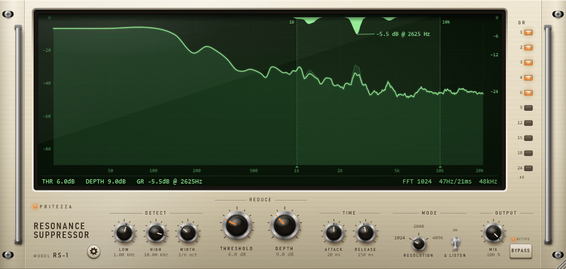
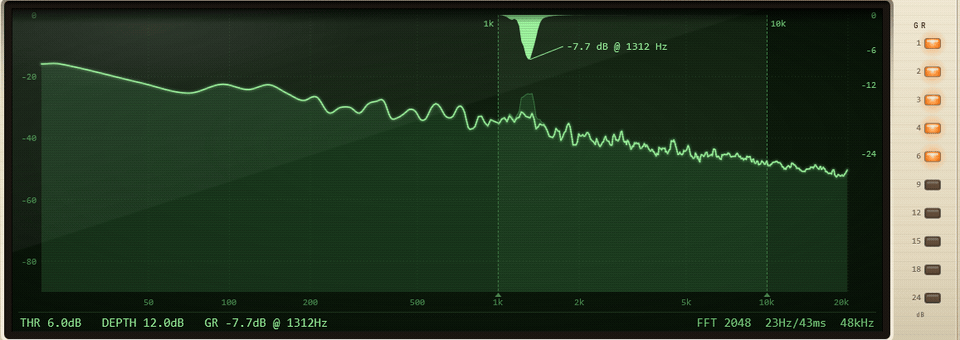
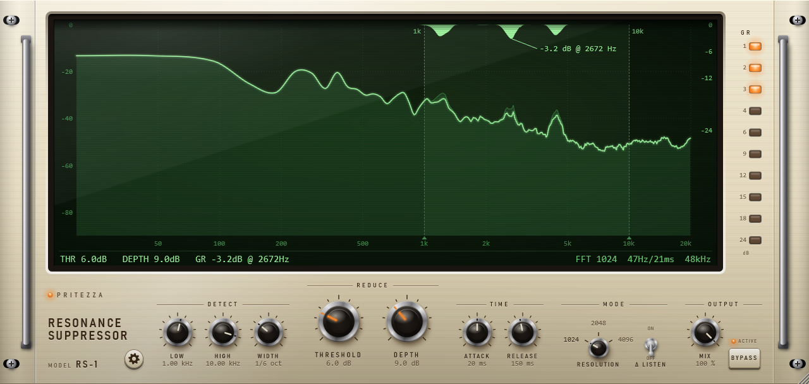
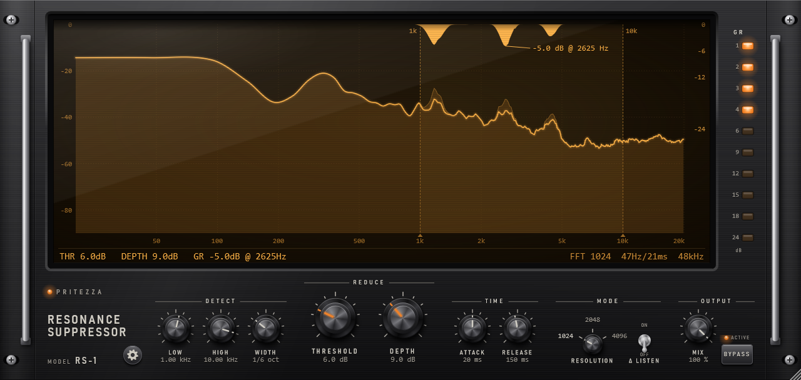
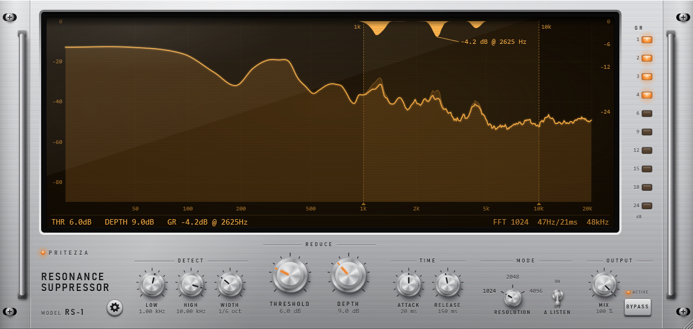
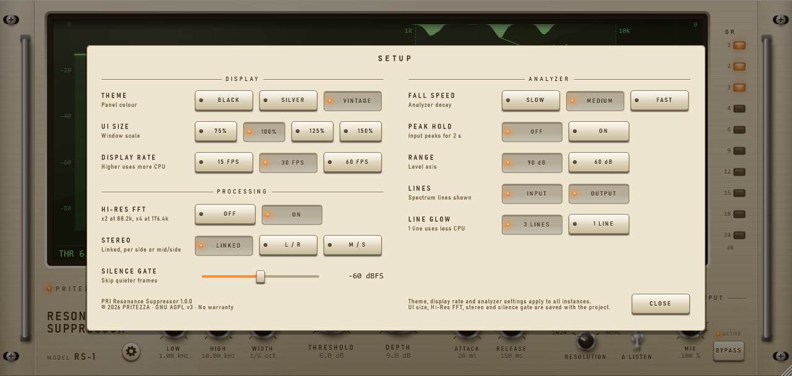

# PRI Resonance Suppressor

[English](README.md) | **日本語**

スペクトル方式の共振抑制プラグインです（Windows 用 VST3）。
周りよりも細く飛び出した周波数（響きすぎ、キーンという鳴り、耳に痛い帯域）を見つけ、その周波数だけを、飛び出している間だけ下げます。



*デモの音は合成音です（ドラム、ベース、和音に共振を 3 つ足したもの）。DEPTH を 9 dB から 18 dB に上げ、そのあと BYPASS を入れて戻しています。*

## 特長

- **音に合わせて動く**: 固定の EQ ではありません。1 秒に何十回も、各周波数を前後の帯域と比べ、飛び出した分だけを削ります。
- **検出の調整**:
  - 範囲（LOW / HIGH）
  - 細さ（WIDTH）
  - 飛び出しの基準（THRESHOLD）
- **削り方の調整**: 最大量（DEPTH）と、かかる・戻る速さ（ATTACK / RELEASE）を決められます。
- **Δ LISTEN と MIX**: Δ LISTEN で削っている成分だけを聞けます。MIX で元の音を混ぜられます。
- **ステレオの扱い**: LINKED / L/R / M/S から選べます。
- **アナライザー**: 入力、出力、周波数ごとの削る量を表示します。
- **テーマと画面の大きさ**: テーマは 3 種類（VINTAGE / BLACK / SILVER）です。画面は 50〜150% で拡大・縮小できます。
- **遅延の報告**: 遅延を DAW に報告するので、トラックのタイミングはずれません。バイパス中も遅延は変わりません。

## 削っている様子



この GIF では、ピンクノイズの上を細い共振（+22 dB）が往復し、プラグインがそれを追いかけて削っています。設定は RESOLUTION 2048、WIDTH 1/12 オクターブ、DEPTH 12 dB です。

| 表示 | 意味 |
|---|---|
| 暗い線 | 入力のスペクトル（左の目盛り、dBFS） |
| 明るい線 | 出力のスペクトル |
| 上から下がる塗り | 周波数ごとの削る量（右の目盛り、dB） |
| 縦の 2 本の破線 | 検出範囲（LOW と HIGH）。ドラッグで動かせる |
| 引き出し線と値 | 今いちばん削っている周波数 |
| 下の行 | THRESHOLD、DEPTH、今の削減量（または SILENT / NO CUT）、使っている FFT の点数 |
| 右の GR メーター | 今の最大の削減量（1〜24 dB） |

## テーマ

テーマは設定画面で切り替えます。

| VINTAGE（既定） | BLACK | SILVER |
|---|---|---|
|  |  |  |

## 設定画面

左下の歯車ボタンで開きます。カードの外をクリックするか、CLOSE を押すと閉じます。カードの左下に、バージョンとライセンスを表示しています。



## インストール

**必要なもの**:
- Windows 10 / 11（64 ビット）
- VST3 に対応した DAW

**手順**:

1. [Releases](https://github.com/pritezza/PRIResonanceSuppressor/releases) のページから、最新のリリースの zip をダウンロードして展開します。
2. `PRI Resonance Suppressor.vst3` フォルダを、`C:\Program Files\Common Files\VST3\` にコピーします。管理者の許可を求められます。
3. DAW を起動します。新しいプラグインが見つからないときは、プラグインを再スキャンします。

プラグインは **PRITEZZA** の **PRI Resonance Suppressor**（カテゴリ Fx / Dynamics）として表示されます。

**アンインストール**:
- `PRI Resonance Suppressor.vst3` フォルダを削除します。
- 表示の設定は `%APPDATA%\PRITEZZA\PRIResonanceSuppressor.settings` に保存されています。すべて消す場合は、このファイルも削除します。

## 使い方

### すぐに使う

1. 響きすぎたり耳に痛かったりするトラックに挿します（ボーカル、アコースティックギター、オーバーヘッド、ミックスのバスなど）。
2. LOW と HIGH を、気になる帯域に合わせます。ノブのほか、液晶の破線をドラッグしても変えられます。
3. THRESHOLD を下げていき、気になる山に削る量の塗りが出るようにします。
4. DEPTH で削る量を決めます。
5. Δ LISTEN を ON にして、削っている成分だけを聞きます。音楽ではなく鳴りが聞こえれば狙いどおりです。確認したら OFF に戻します。
6. 効きすぎるときは、MIX を下げて元の音を混ぜます。

### 操作部

| 区分 | 操作 | 範囲（既定） | 働き |
|---|---|---|---|
| DETECT | LOW / HIGH | 25 Hz〜20 kHz（1 kHz / 10 kHz） | 共振を探して削る周波数の範囲 |
| | WIDTH | 1/3〜1/48 オクターブ（1/6） | どれだけ細い山を共振とみなすか。細くすると、細く飛び出した山だけを削る |
| REDUCE | THRESHOLD | 1〜20 dB（6 dB） | 周りより何 dB 飛び出したら削るか。小さいほど敏感 |
| | DEPTH | 1〜24 dB（9 dB） | 削る量の上限 |
| TIME | ATTACK | 1〜200 ms（20 ms） | 削り始める速さ |
| | RELEASE | 10〜2000 ms（150 ms） | 元に戻る速さ |
| MODE | RESOLUTION | 1024 / 2048 / 4096（1024） | FFT の点数。大きいほど細かい周波数で見分けられるが、遅延が増える（下の表） |
| | Δ LISTEN | OFF / ON | 削っている成分だけを出す（MIX を下げるとその分小さくなる）。プロジェクトを開いたときは常に OFF |
| OUTPUT | MIX | 0〜100%（100%） | 処理後の音と元の音の割合 |
| | BYPASS | OFF / ON | 元の音にクロスフェードで切り替える。遅延は変わらない |
| | 歯車ボタン | | 設定画面を開く |

**マウスでの操作**:
- **ノブ**: 上下にドラッグして回します。ダブルクリックで既定値に戻ります。
- **検出範囲**: 液晶の破線をドラッグして LOW と HIGH を変えます。2 本は互いを越えません。重なっているときは、右へ動かすと HIGH、左へ動かすと LOW が動きます。
- **RESOLUTION**: 上下のドラッグかマウスホイールで切り替えます。数字をクリックするとその点数に、ノブをクリックすると次の点数になります。
- **画面の大きさ**: 右下の角をドラッグして変えます（50〜150%）。

**コツ**:
- 細くキーンと鳴る山には、WIDTH を細く（1/24〜1/48）し、RESOLUTION を 2048 か 4096 にします。
- 広めの耳障りな帯域や、遅延を小さくしたいときは、WIDTH を広く（1/3〜1/6）し、RESOLUTION を 1024 にします。
- 検出範囲に伸ばしたシンセの音のような持続音があると、それも周りより飛び出しているので削られます。そのときは範囲を狭めるか、THRESHOLD を上げます。

### 遅延

遅延は FFT の点数と同じサンプル数です。

| RESOLUTION | 44.1 kHz | 48 kHz |
|---|---|---|
| 1024 | 23 ms | 21 ms |
| 2048 | 46 ms | 43 ms |
| 4096 | 93 ms | 85 ms |

- HI-RES FFT が ON（既定）のときは、88.2 / 96 kHz で点数を 2 倍、176.4 / 192 kHz で 4 倍にします。そのため、周波数の細かさとミリ秒での遅延は 44.1 / 48 kHz のときと同じです。
- RESOLUTION、HI-RES FFT、STEREO は、遅延や削り方が変わるので、オートメーションできません。
- DAW によっては、再生を止めるまで遅延の補正が変わらないことがあります。
- RESOLUTION を切り替えた瞬間は、音が少し飛びます。

### 設定

「パソコン」の項目は、そのパソコンのすべてのインスタンスで共通です。「プロジェクト」の項目は、DAW のプロジェクトに保存されます。

| 項目 | 選択肢（既定） | 保存先 |
|---|---|---|
| THEME | VINTAGE / BLACK / SILVER（VINTAGE） | パソコン |
| UI SIZE | 75 / 100 / 125 / 150%（100%）。右下の角のドラッグでも変わる | プロジェクト |
| DISPLAY RATE | 15 / 30 / 60 FPS（30 FPS）。高いほど CPU を使う | パソコン |
| HI-RES FFT | OFF / ON（ON）。[遅延](#遅延) を参照 | プロジェクト |
| STEREO | LINKED: 左右に同じ量をかける（既定）<br>L/R: 左右を別々に削る<br>M/S: 中央と左右差を別々に削る<br>ステレオのトラックでだけ効く。L/R と M/S のときは液晶の右下に表示される | プロジェクト |
| SILENCE GATE | −90〜−30 dBFS（−60）。これより静かな音は処理せず、同じ遅延だけかけて通す | プロジェクト |
| FALL SPEED | SLOW / MEDIUM / FAST: アナライザーの落ちる速さ（毎秒 15 / 45 / 120 dB、既定 MEDIUM）。GR メーターは常に毎秒 45 dB | パソコン |
| PEAK HOLD | OFF / ON（OFF）。入力の最大値を 2 秒残す | パソコン |
| RANGE | 90 dB / 60 dB（90 dB）。アナライザーの縦軸の範囲 | パソコン |
| LINES | INPUT / OUTPUT（両方 ON）。表示するスペクトルの線 | パソコン |
| LINE GLOW | 3 LINES: 出力の線をにじませる（既定）<br>1 LINE: 線 1 本だけ。CPU の負荷が小さい | パソコン |

## 仕組み

1. 短時間 FFT（Hann 窓、75% 重ね）で音を分析します。
2. フレームごとに、各周波数の周り（±WIDTH/2）のレベルを、そのすぐ下とすぐ上の帯域の平均と比べます。
3. THRESHOLD より飛び出していれば、その超えた分を DEPTH まで削ります。
4. 削る量を周波数方向と時間方向（ATTACK / RELEASE）にならし、周波数ごとのゲインとして掛けて音に戻します。

**帯域の欠けた音**: MP3 の高域カットより上のように音がない帯域は、比べる対象に入れません。そのため、カットの手前を共振と見誤りません。

**オーバーサンプリング**: 周波数ごとにゲインを掛けるだけで歪みを足さないので、使っていません。

**CPU**:
- 音の処理は軽めです。
- アナライザーはソフトウェアで描くので、音の処理より CPU を使います。重いときは、DISPLAY RATE を下げるか、LINE GLOW を 1 LINE にします。

## ソースからのビルド

**必要なもの**:
- Windows 10 以降
- Visual Studio 2026（「C++ によるデスクトップ開発」）
- CMake 3.22 以降

**ビルド**:

```powershell
git clone --depth 1 --branch 8.0.16-security https://github.com/juce-framework/JUCE.git external/JUCE
cmake -S . -B build -G "Visual Studio 18 2026" -A x64
cmake --build build --config Release
```

プラグインは `build/PRIResonanceSuppressor_artefacts/Release/VST3/PRI Resonance Suppressor.vst3` にできます。`C:\Program Files\Common Files\VST3` へのコピーは管理者権限が要るので、ビルドでは行いません。

リンク時最適化（LTO）は、配布用のビルドに必要なので既定で ON です。リンクが遅くなるので、開発中は `-DPRI_ENABLE_LTO=OFF` で構成すると速くなります。配布用のビルドを作る前に ON に戻してください。

開発用のツールは、既定ではビルドされません。確認用のツール、負荷の測定、README の画像の作成がこれに当たります。詳しくは [docs/DEVELOPMENT.ja.md](docs/DEVELOPMENT.ja.md) を参照してください。

### 識別子

| 項目 | 値 |
|---|---|
| 製造元コード | `Prtz` |
| プラグインコード | `Rsup` |
| バンドル ID | `com.pritezza.PRIResonanceSuppressor` |

DAW はこれらのコードで、プロジェクトとプラグインを結び付けます。公開後は変えないでください。

## ライセンス

Copyright (C) 2026 PRITEZZA

このプログラムはフリーソフトウェアです。Free Software Foundation が公表した GNU Affero General Public License 第 3 版の条件で、再配布や改変ができます。無保証です。詳しくは [LICENSE](LICENSE)（英語）を参照してください。

**第三者のソフトウェア**:
- [JUCE](https://juce.com) を AGPLv3 で使っています。
- VST 3 SDK（MIT ライセンス）も使っています。
- プラグインに含まれる第三者のソフトウェアのライセンスは、[THIRD_PARTY_NOTICES.txt](THIRD_PARTY_NOTICES.txt) にまとめています。

VST は Steinberg Media Technologies GmbH の登録商標です。
