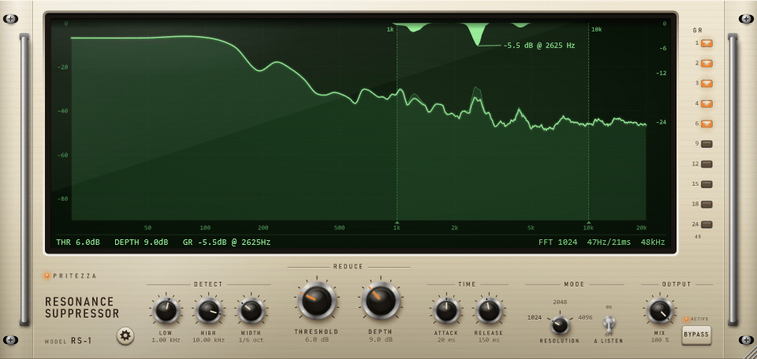
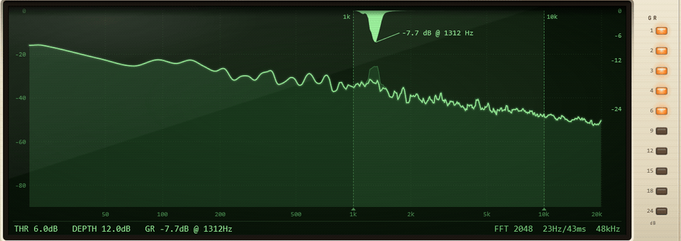
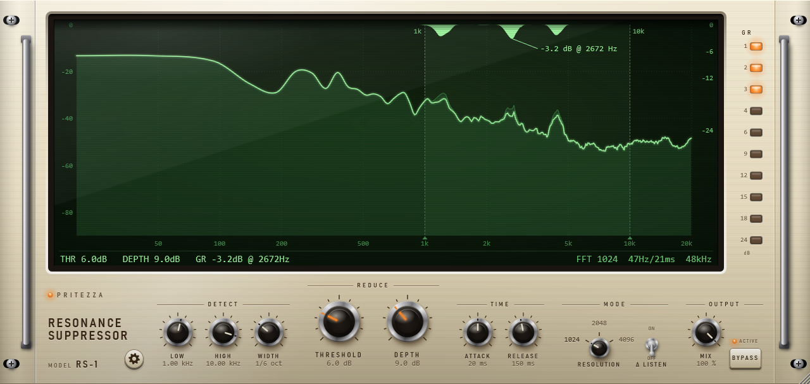
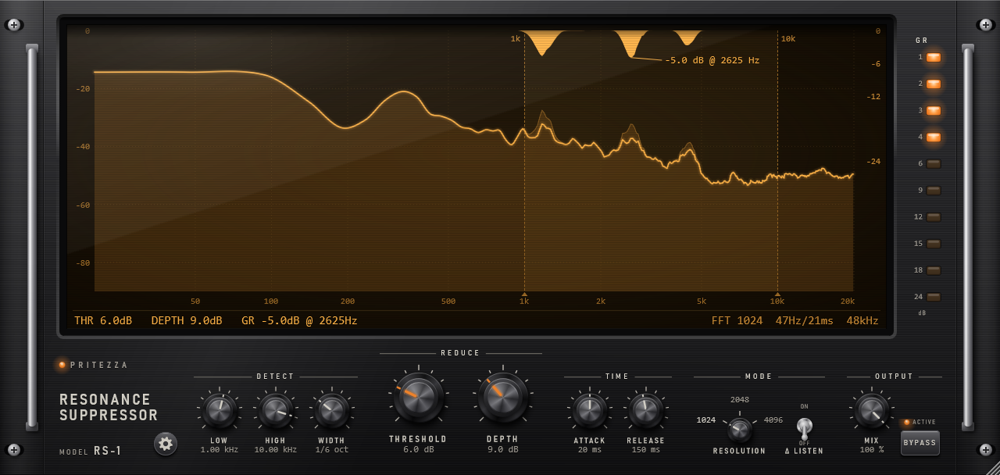
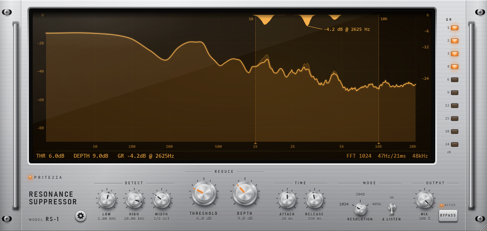
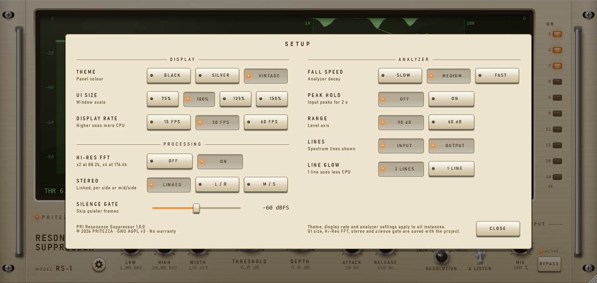

# PRI Resonance Suppressor

**English** | [日本語](README.ja.md)

A spectral resonance suppressor plug-in (VST3 for Windows).
It finds narrow peaks that stick out of the surrounding spectrum, such as ringing, whistling and harsh frequencies. It turns down only those frequencies, and only while they stick out.



*The demo sound is synthesised: drums, bass and chords, with three resonances added. In the clip, DEPTH rises from 9 to 18 dB, then BYPASS is switched on and off.*

## Features

- **Follows the sound.** Instead of a fixed EQ cut, it compares every frequency with its neighbours, many times per second, and reduces only what sticks out.
- **Detection controls.**
  - Set the frequency range with LOW and HIGH.
  - Set how narrow a peak must be with WIDTH.
  - Set how far a peak must stick out with THRESHOLD.
- **Reduction controls.** Set the maximum reduction with DEPTH, and its speed with ATTACK and RELEASE.
- **Δ LISTEN** plays only what is being removed. **MIX** blends in the unprocessed sound.
- **Stereo modes:** LINKED, L/R or M/S.
- **Built-in analyzer** showing the input, the output and the reduction at every frequency.
- **Three themes** (VINTAGE, BLACK, SILVER). The window can be resized from 50% to 150%.
- **Latency** is reported to the host, so the DAW keeps the track in time. It stays the same while bypassed.

## Reduction in action



In this demo, a narrow resonance (+22 dB) sweeps back and forth over pink noise, and the plug-in follows it. The settings are RESOLUTION 2048, WIDTH 1/12 octave and DEPTH 12 dB.

| On the display | Meaning |
|---|---|
| Dim line | Input spectrum (left scale, dBFS) |
| Bright line | Output spectrum |
| Shaded area hanging from the top | Amount of reduction at each frequency (right scale, dB) |
| Two vertical dashed lines | Detection range (LOW and HIGH). Drag them to change the range. |
| Leader line and value | The frequency with the largest reduction right now |
| Bottom row | THRESHOLD, DEPTH, current reduction (or SILENT / NO CUT), and the FFT size in use |
| GR meter (right) | The largest reduction right now, from 1 to 24 dB |

## Themes

Change the theme from the settings screen.

| VINTAGE (default) | BLACK | SILVER |
|---|---|---|
|  |  |  |

## Settings screen

Click the gear button at the bottom left to open it. Click outside the card or click CLOSE to close it. The version and licence are shown at the bottom left of the card.



## Installation

**Requirements:**
- Windows 10 or 11 (64-bit).
- A DAW that supports VST3 plug-ins.

**Steps:**

1. Download the latest release zip from the [Releases](https://github.com/pritezza/PRIResonanceSuppressor/releases) page and extract it.
2. Copy the `PRI Resonance Suppressor.vst3` folder into `C:\Program Files\Common Files\VST3\`. Windows asks for administrator permission.
3. Start your DAW, and rescan plug-ins if it doesn't find the new one automatically.

The plug-in appears as **PRI Resonance Suppressor** by **PRITEZZA**, in the Fx / Dynamics category.

**Uninstalling:**
- Delete the `PRI Resonance Suppressor.vst3` folder.
- Display settings are saved in `%APPDATA%\PRITEZZA\PRIResonanceSuppressor.settings`. Delete this file too if you want to remove everything.

## Usage

### Quick start

1. Insert the plug-in on a track that rings or sounds harsh, for example vocals, acoustic guitar, overheads or a mix bus.
2. Set LOW and HIGH to cover the problem area. You can turn the knobs or drag the dashed lines on the display.
3. Lower THRESHOLD until the shaded reduction appears on the problem peaks.
4. Set DEPTH to how much you want to take off.
5. Turn on Δ LISTEN to hear only what is being removed. You should hear the ringing, not the music. Turn it off again when you're done.
6. If the result is too strong, lower MIX to blend some of the unprocessed sound back in.

### Controls

| Section | Control | Range (default) | What it does |
|---|---|---|---|
| DETECT | LOW / HIGH | 25 Hz – 20 kHz (1 kHz / 10 kHz) | Frequency range where resonances are detected and reduced. |
| | WIDTH | 1/3 – 1/48 octave (1/6) | How narrow a peak must be to count as a resonance. Narrower settings catch only thin peaks. |
| REDUCE | THRESHOLD | 1 – 20 dB (6 dB) | How far a peak must stick out above its surroundings before it is reduced. Lower values are more sensitive. |
| | DEPTH | 1 – 24 dB (9 dB) | Maximum reduction. |
| TIME | ATTACK | 1 – 200 ms (20 ms) | How quickly the reduction is applied. |
| | RELEASE | 10 – 2000 ms (150 ms) | How quickly the reduction recovers. |
| MODE | RESOLUTION | 1024 / 2048 / 4096 (1024) | FFT size. Larger sizes separate frequencies more finely, but add latency (see below). |
| | Δ LISTEN | OFF / ON | Outputs only the removed sound, scaled by MIX. It always turns off when a project is loaded. |
| OUTPUT | MIX | 0 – 100% (100%) | Balance between the processed and the unprocessed sound. |
| | BYPASS | OFF / ON | Crossfades to the unprocessed sound. The latency stays the same. |
| | Gear button | | Opens the settings screen. |

**Mouse operation:**
- **Knobs:** Drag up or down to turn a knob. Double-click to reset it to its default.
- **Detection range:** Drag the dashed lines on the display to set LOW and HIGH. The two lines can't cross. When they overlap, dragging right moves HIGH and dragging left moves LOW.
- **RESOLUTION:** Drag up or down, or use the mouse wheel. You can also click a number to select it, or click the knob to step to the next size.
- **Window size:** Drag the bottom-right corner to resize the window (50–150%).

**Tips:**
- For thin, ringing peaks, try a narrow WIDTH (1/24 – 1/48) with RESOLUTION 2048 or 4096.
- For broader harshness, or when you need low latency, try a wide WIDTH (1/3 – 1/6) with RESOLUTION 1024.
- Steady tones inside the detection range, such as long synth notes, also stick out from their surroundings and get reduced. Narrow the range or raise THRESHOLD if that happens.

### Latency

The latency equals the FFT size.

| RESOLUTION | 44.1 kHz | 48 kHz |
|---|---|---|
| 1024 | 23 ms | 21 ms |
| 2048 | 46 ms | 43 ms |
| 4096 | 93 ms | 85 ms |

- With HI-RES FFT on (the default), the FFT size is doubled at 88.2/96 kHz and quadrupled at 176.4/192 kHz. The frequency resolution and the latency in milliseconds therefore stay the same as at 44.1/48 kHz.
- RESOLUTION, HI-RES FFT and STEREO change the latency or the way the sound is processed, so they can't be automated.
- Some DAWs update their delay compensation only after playback stops.
- Changing RESOLUTION causes a short glitch in the sound.

### Settings

"Computer" settings are shared by all instances on the computer. "Project" settings are saved with the DAW project.

| Setting | Choices (default) | Saved in |
|---|---|---|
| THEME | VINTAGE / BLACK / SILVER (VINTAGE) | Computer |
| UI SIZE | 75 / 100 / 125 / 150% (100%). Dragging the corner also changes it. | Project |
| DISPLAY RATE | 15 / 30 / 60 FPS (30 FPS). Higher rates use more CPU. | Computer |
| HI-RES FFT | OFF / ON (ON). See [Latency](#latency). | Project |
| STEREO | LINKED: the same reduction on both channels (default).<br>L/R: left and right reduced separately.<br>M/S: mid and side reduced separately.<br>Works only on stereo tracks. L/R and M/S are shown at the bottom right of the display. | Project |
| SILENCE GATE | −90 to −30 dBFS (−60). Quieter sound passes through unprocessed, still delayed by the same latency. | Project |
| FALL SPEED | SLOW / MEDIUM / FAST: how fast the analyzer falls (15 / 45 / 120 dB per second, default MEDIUM). The GR meter always falls at 45 dB per second. | Computer |
| PEAK HOLD | OFF / ON (OFF). Holds the input peaks for 2 seconds. | Computer |
| RANGE | 90 dB / 60 dB (90 dB): the level range of the analyzer. | Computer |
| LINES | INPUT / OUTPUT (both on): which spectrum lines to show. | Computer |
| LINE GLOW | 3 LINES (default): the output line has a soft glow.<br>1 LINE: a single line, which uses less CPU. | Computer |

## How it works

1. The sound is analysed with a short-time FFT (Hann window, 75% overlap).
2. In each frame, the level around each frequency (±WIDTH/2) is compared with the average level of the bands just below and just above it.
3. Wherever it sticks out by more than THRESHOLD, the excess is reduced, up to DEPTH.
4. The reduction is smoothed across frequencies and over time (ATTACK / RELEASE). It is then applied as a gain at each frequency, and the sound is resynthesised.

**Band-limited material:** Frequencies with no content, such as the range above the high-frequency cutoff of an MP3, are left out of the comparison. The edge of the cutoff is therefore not mistaken for a resonance.

**Oversampling:** The processing only changes the gain at each frequency and adds no distortion, so it isn't needed.

**CPU:**
- The audio processing is light.
- The analyzer is drawn in software and uses more CPU than the audio. If CPU is tight, lower DISPLAY RATE or set LINE GLOW to 1 LINE.

## Building from source

**Requirements:**
- Windows 10 or later.
- Visual Studio 2026 with the "Desktop development with C++" workload.
- CMake 3.22 or later.

**Build:**

```powershell
git clone --depth 1 --branch 8.0.16-security https://github.com/juce-framework/JUCE.git external/JUCE
cmake -S . -B build -G "Visual Studio 18 2026" -A x64
cmake --build build --config Release
```

The plug-in is written to `build/PRIResonanceSuppressor_artefacts/Release/VST3/PRI Resonance Suppressor.vst3`. Copying it into `C:\Program Files\Common Files\VST3` needs administrator rights, so the build doesn't do it.

Link-time optimisation (LTO) is on by default, as release builds need it. It slows down linking. For quicker development builds, configure with `-DPRI_ENABLE_LTO=OFF`, and switch it back on before making a release.

The development tools are not built by default. These are the checks, the benchmark and the README image generator. See [docs/DEVELOPMENT.md](docs/DEVELOPMENT.md).

### Identifiers

| Item | Value |
|---|---|
| Manufacturer code | `Prtz` |
| Plug-in code | `Rsup` |
| Bundle ID | `com.pritezza.PRIResonanceSuppressor` |

DAW projects use these codes to find the plug-in again. Don't change them after a release.

## License

Copyright (C) 2026 PRITEZZA

This program is free software: you can redistribute it and/or modify it under the terms of the GNU Affero General Public License version 3, as published by the Free Software Foundation. It is distributed WITHOUT ANY WARRANTY. See [LICENSE](LICENSE) for details.

**Third-party software:**
- The plug-in is built with [JUCE](https://juce.com), used under the AGPLv3.
- It also uses the VST 3 SDK, which is under the MIT License.
- The licences of all third-party software included in the plug-in are listed in [THIRD_PARTY_NOTICES.txt](THIRD_PARTY_NOTICES.txt).

VST is a registered trademark of Steinberg Media Technologies GmbH.
